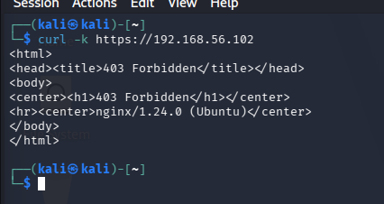
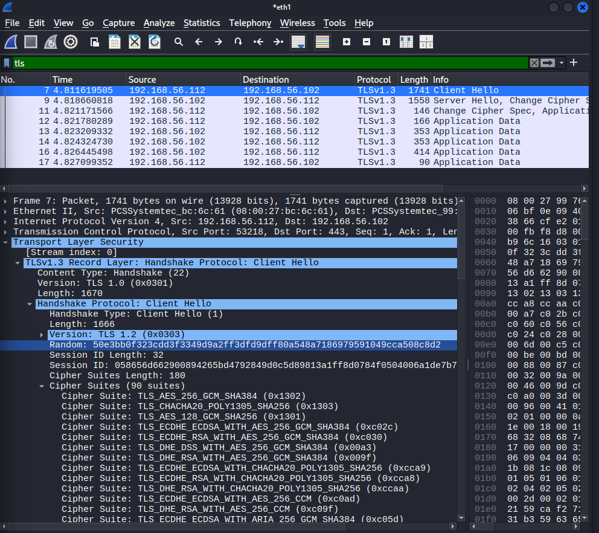
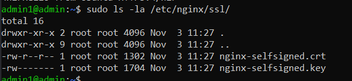

# Неделя 5: TLS, Wireshark

## 1. HTTPS и TLS

HTTPS — это HTTP, работающий поверх TLS (шифрования).
Порт 443 (вместо 80 для HTTP).

### Настройка HTTPS на Ubuntu (nginx)

1. Установка nginx:
   sudo apt install -y nginx

2. Создание самоподписанного сертификата:
   sudo openssl req -x509 -nodes -days 365 -newkey rsa:2048 \
     -keyout /etc/nginx/ssl/nginx-selfsigned.key \
     -out /etc/nginx/ssl/nginx-selfsigned.crt \
     -subj "/C=LT/ST=Vilnius/L=Vilnius/O=Lab/CN=ubuntu.lab.local"

3. Настройка конфига nginx:
   Блок server с listen 443 ssl, ssl_certificate, ssl_certificate_key.

4. Создание тестовой страницы:
   echo "<h1>Hello from Ubuntu HTTPS!</h1>" > /var/www/html/index.html

### Проверка с Kali

curl -k https://192.168.56.102
→ <h1>Hello from Ubuntu HTTPS!</h1>

Флаг -k нужен, потому что сертификат самоподписанный (браузер/curl ему не доверяет).

## 2. TLS Handshake в Wireshark

Захват на eth1 (host-only) с Kali.

Фильтр: tls

Пакеты:
- Client Hello — клиент предлагает версии TLS, шифры (Cipher Suites), SNI.
- Server Hello — сервер выбирает шифр.
- Change Cipher Spec — переход на шифрование.
- Application Data — зашифрованный трафик.

Скриншоты:

